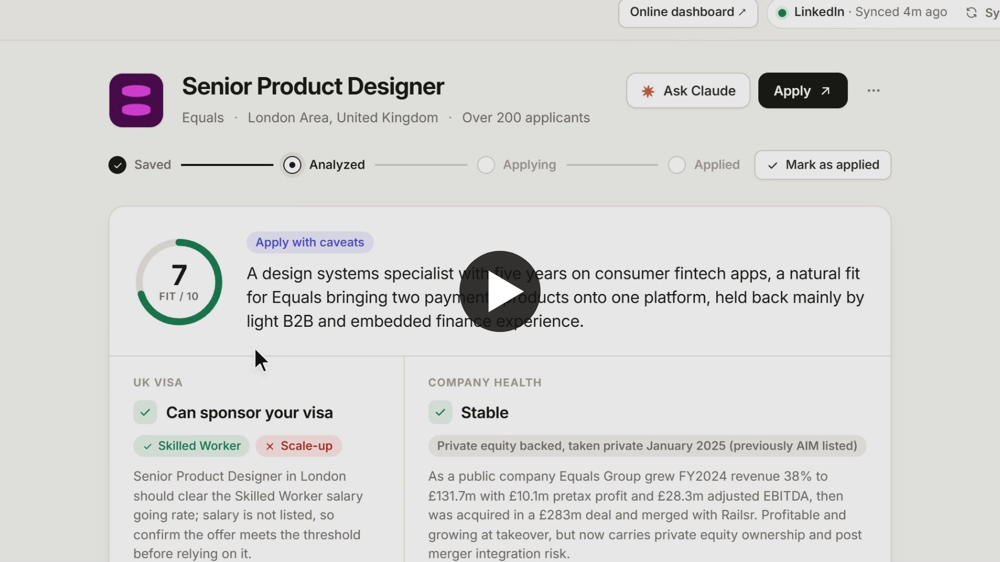

# Job Analyzer

**Know if a job is worth your time, before you apply.**

Job Analyzer is a personal tool for job hunting in the UK on a work visa. Every saved job raises the
same three questions: *can they sponsor my visa, do I really fit, and is the company healthy?*
Answering them by hand takes 20 to 30 minutes per job. Job Analyzer answers them in about three
minutes, then helps you apply.

▶ **[Watch the 90 second demo](job-analyzer-demo.mp4)**

> This repository is a showcase only: the overview and the demo video. The source code is private.

## How it works

1. **Save jobs on LinkedIn, as usual.** On your laptop or your phone. A small browser extension
   picks up your saved jobs and brings each one into the dashboard, with the logo, the company and
   the full job description. There's no "Add job" form to fill in.
2. **Pick a job and click Analyze.** Nothing runs until you ask. Claude then:
   - reads the role,
   - checks today's **UK Register of Licensed Sponsors** (from gov.uk) for the company and its legal
     entities,
   - researches the company on the web: funding, revenue, profit, ownership and risks,
   - compares the job with your CV and profile.
3. **Get a straight answer.** One card with a fit score out of 10, a verdict (for example
   *Apply with caveats*) and a one line summary, followed by:
   - **Visa:** whether the company can sponsor a **Skilled Worker** or **Scale-up** visa, with the
     evidence from the register.
   - **Company health:** stable, growing or risky, with the numbers behind it.
   - **Why you fit / Watch outs:** your real strengths for the role and the gaps to be ready for.
     Nothing is stretched and no experience is invented.
   - **Worth checking:** questions about things the role asks for that your CV doesn't show yet.
4. **Apply with Claude beside you.** A chat panel sits next to the report. Ask for a tailored CV or a
   cover letter, or paste application questions, and download the result as a PDF.
5. **Track where every job stands:** Saved → Analyzed → Applying → Applied.

## Your profile

Upload your CV (PDF or Word) and the CV text is rebuilt automatically. Add your LinkedIn and portfolio,
plus notes, and every analysis uses them.

## Private by design

- **Runs on your own laptop.** The analysis uses Claude Code with your own Claude subscription.
  There's **no API key** and no per-request bill.
- **Your data stays with you.** Jobs, reports and your CV are stored locally.
- **Optional online dashboard.** It's useful on your phone. The website only queues the work; your
  laptop does the analysis and sends the result back.

## Built with

Node.js · Claude Code · a Chrome extension (Manifest V3) · the gov.uk sponsor register · PDF
generation for CVs and cover letters.

---

© 2026 @MahshidAtabaki on GitHub. All rights reserved. No licence is granted to use, copy, modify or
distribute this project, its design or its demo.

*The person in the demo, "Alex Morgan", is fictional. Company information shown comes from a real
analysis of a public job listing.*
